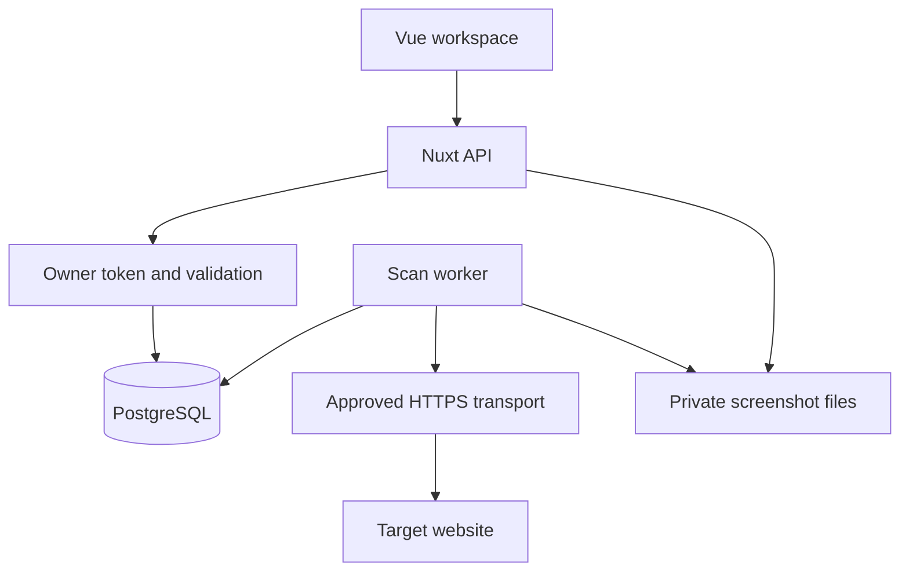

# Architecture

Nuxt serves the Vue interface and HTTP API. PostgreSQL is both the source of truth and the small durable job queue. A separate Node process claims work and runs Playwright. Browser work never runs inside an HTTP request.

## Request flow

1. Owner submits a project name and up to five paired URLs.
2. The API authenticates, bounds and validates the request, and creates the project, pairs, and queued scan in one transaction.
3. The worker claims a job with `FOR UPDATE SKIP LOCKED`. Each page runs in an isolated browser context at desktop and mobile sizes.
4. A pure rule engine turns observed values into findings. Stable keys include page pair, locale, viewport, and check.
5. A successful scan writes page results, findings, and its report in one transaction. Failed scans stay failed; an expired worker lease never becomes a successful report.
6. The owner polls the scan and requests screenshots with the same authorization header. Reruns compare against the previous completed scan for that project.

## Why this structure

Components render a focused piece of the interface. Pages compose them. `useOwnerScans` owns request/polling lifecycle. The backend has HTTP validation at the boundary, pure rules that are easy to test, and explicit SQL instead of a second abstraction layer.

A separate queue service, generic repositories, multi-user tenancy, and billing would add operations before they solve a current need. PostgreSQL transactions and a single owner are enough for this release.

## Known limits

- Eight checks cover initial-viewport quality, not a full crawl or SEO certification.
- Exact paired URLs are supplied manually. Canonicals are exact URL comparisons after removing fragments; trailing-slash routes may be distinct.
- Resource allowlists, GET-only fetching, lack of cookies, and resource budgets may prevent some applications from rendering faithfully. Review blocked requests.
- A shared owner token is not a substitute for multi-user authentication.
- Screenshots use a private local volume. A managed object store is a later deployment option.
- The public demo is synthetic fixture evidence. It must never be described as a live audit.
